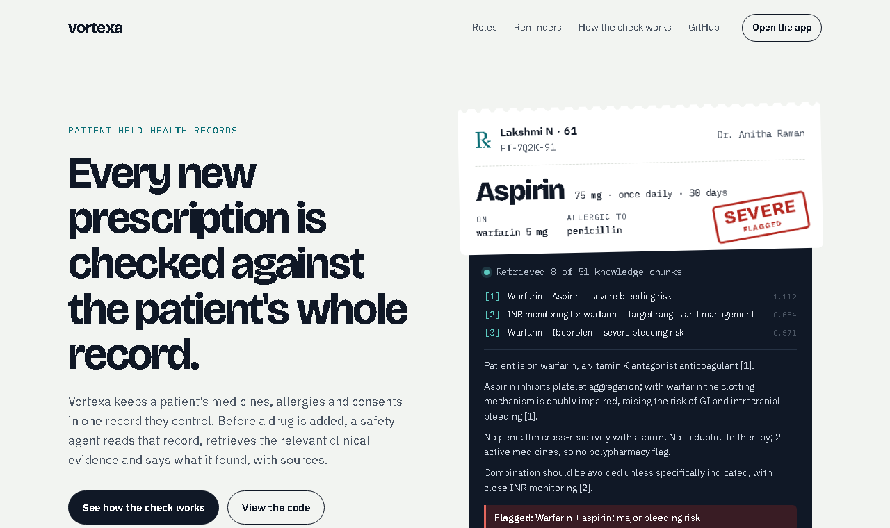

# Vortexa

Patient-held health records with an AI safety agent. The patient owns one
record of their medicines, allergies, lab results and consents. Before a doctor
adds a drug, the safety agent reads that record, retrieves relevant clinical
evidence and returns a verdict with the sources it used.

Built in 24 hours for a hackathon.



## What's in this repo

```
Vortexa/
├── backend/   Firebase project: Cloud Functions, Firestore + Storage rules, seed scripts
├── web/       React + Vite web app (showcase page at "/", live app at "/app")
├── mobile/    Expo / React Native app for patients, doctors, pharmacists and lab techs
└── docs/      Images used in this README
```

| Folder | Stack | Start here |
|---|---|---|
| [`backend/`](backend) | Firebase Functions (Node 20), Firestore, Gemini, Chroma Cloud | [`backend/README.md`](backend/README.md), [`backend/SCHEMA.md`](backend/SCHEMA.md) |
| [`web/`](web) | React 18, Vite, Firebase web SDK | [`web/SETUP.md`](web/SETUP.md) |
| [`mobile/`](mobile) | Expo 51, React Native, `@react-native-firebase` | [`mobile/SETUP.md`](mobile/SETUP.md) |

## Features

- **Prescription safety agent.** A new prescription triggers a Cloud Function
  that retrieves from a 51-chunk clinical knowledge base (interactions, allergy
  contraindications, guidelines, dosage warnings, lab correlations), asks
  Gemini to reason only from that evidence, and writes back a verdict, severity,
  reasoning and cited sources. If anything fails, the prescription is flagged
  for manual review rather than marked clear.
- **Hermes reminders.** A scheduled function runs every minute and sends dose
  reminders in the patient's time zone, day-ahead appointment and token
  reminders, and follow-up reminders. Doses not marked within two hours are
  logged as missed.
- **Patient chat.** `hermesChat` answers questions about the patient's own
  prescriptions, appointments and adherence.
- **Consent.** Providers request access by scope; patients approve or revoke.
- **Roles.** Patient, doctor, pharmacist and lab tech each get their own app.

## Run it

**Showcase only (no Firebase needed):**

```bash
cd web
npm install
npm run dev
```

Open http://localhost:5173. The page at `/` uses static, fictional data.

**Full stack:** follow [`backend/README.md`](backend/README.md) to set up Firebase,
the Gemini key and Chroma, then open http://localhost:5173/app for the live web
app, or see [`mobile/SETUP.md`](mobile/SETUP.md) for the phone app.

Secrets live in `backend/functions/.env` (never committed). The web app's
Firebase config in `web/src/firebase.js` is a public client config, not a secret.

## Status

Hackathon prototype, not production software. Known gaps before real patient
data could go near it:

- Anyone can register as a provider, and providers can read every patient's
  record. Consent is shown in the UI but not enforced by Firestore rules or
  Cloud Functions.
- Several callable functions (`askSafetyAgent`, `bookAppointment`,
  `createDoseSchedule`, `createFollowup`) don't check who is calling.
- PIN and signature checks run in the browser only.
- Mobile encrypts prescription fields, which hides the drug name from the
  server-side safety agent.

## Branches

`main` is the organised monorepo. The older `backend` and `frontend` branches
are kept as they were; their history is included in `main`.
